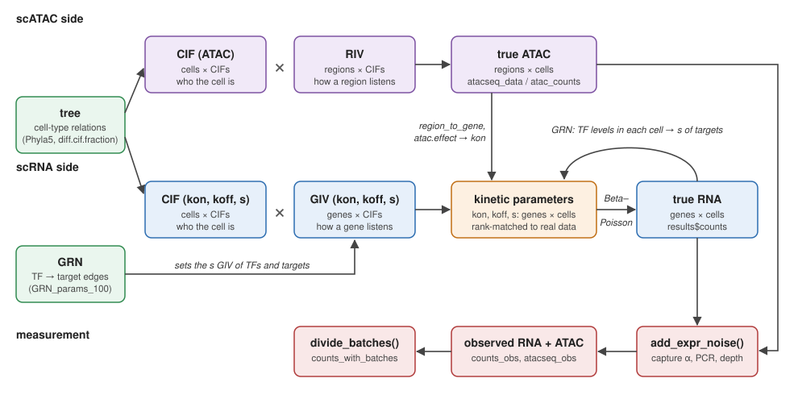

# Simulating single-cell multiome data with scMultiSim

A hands-on tutorial on simulating paired scRNA-seq + scATAC-seq data with
[scMultiSim](https://github.com/ZhangLabGT/scMultiSim) (Li et al., *Nature Methods* 2025,
[doi:10.1038/s41592-025-02651-0](https://doi.org/10.1038/s41592-025-02651-0)).

It is written for a mixed audience of biologists and computational scientists. You will:

- simulate five related cell types with a gene regulatory network and chromatin accessibility,
- look inside the simulator: **cell identity factors (CIF)**, **gene identity vectors (GIV)**,
  **region identity vectors (RIV)** and the kinetic parameters they produce,
- compute the **true mean and noise** of every gene in every cell type from those parameters,
- add **technical noise** (capture, amplification, sequencing depth, batches) and see what it does
  to means, noise, zeros and cell-type structure,
- try to estimate mean and noise back from the noisy data.



## Contents

| File | What it is |
|------|------------|
| `Tutorial_scMultiSim.Rmd` | the tutorial: open it in RStudio and run it chunk by chunk |
| `docs/index.html` | the rendered tutorial with all outputs, for reading along or catching up |
| `environment.yml` | conda environment with everything needed |
| `setup_check.R` | checks your installation and runs a tiny simulation |
| `figures/` | the model diagram |

## Setup (do this before the session)

The simplest, most portable route is a conda environment. Installing from conda avoids compiling
Bioconductor packages and their system libraries yourself.

**1. Install a conda distribution** if you do not have one. We recommend
[Miniforge](https://github.com/conda-forge/miniforge) (it includes `mamba`, a faster `conda`).

**2. Get the tutorial:**

```bash
git clone https://github.com/<your-github-username>/tutorial_scMultiSim.git
cd tutorial_scMultiSim
```

**3. Create the environment** (5–10 minutes the first time):

```bash
mamba env create -f environment.yml
```

(Use `conda` instead of `mamba` if you do not have mamba.)

**4. Check that it works:**

```bash
conda activate scmultisim
Rscript setup_check.R
```

You should see `All good: ... You are ready for the tutorial.`

### Running the tutorial

**RStudio.** RStudio has to use the R from the conda environment. The easiest way is to start
it from a terminal where the environment is active:

```bash
conda activate scmultisim
rstudio &
```

On macOS, RStudio started from the Dock ignores conda. Start it from the terminal with
`open -na RStudio`, or set `RSTUDIO_WHICH_R` to the output of `which R` inside the environment.
Then open `Tutorial_scMultiSim.Rmd` and run the chunks one by one (Ctrl/Cmd + Shift + Enter).
Check with `R.home()` that you are in the conda R.

**VS Code / Positron.** Select the R interpreter in `<conda prefix>/envs/scmultisim/bin/R`.

**Command line only.** Render the whole document (about 3 minutes):

```bash
conda activate scmultisim
Rscript -e 'rmarkdown::render("Tutorial_scMultiSim.Rmd", output_dir = "docs", output_file = "index.html")'
```

### Windows

Most Bioconductor packages on bioconda are built for Linux and macOS only. On Windows, either:

- use **WSL2** (Ubuntu) and follow the steps above inside it, or
- install R ≥ 4.4 from CRAN plus RStudio, then in R:

  ```r
  install.packages(c("BiocManager", "ape", "Rtsne", "MASS", "rmarkdown"))
  BiocManager::install(c("scMultiSim", "SingleCellExperiment", "scuttle", "scran"))
  ```

The same `BiocManager` route works on any system without conda.

### Optional: BASiCS

The appendix uses BASiCS, which is large and slow to run. It is not needed for the session:

```bash
mamba install -n scmultisim -c conda-forge -c bioconda bioconductor-basics
```

## Troubleshooting

- **`the value should be an integer vector`.** scMultiSim checks integers strictly.
  Use `300L`, `rep(300L, 5L)` and so on for counts of cells, genes and CIFs.
- **RStudio cannot find `scMultiSim`.** RStudio is using a different R. Run `R.home()` in the
  RStudio console. It should point into `.../envs/scmultisim/`.
- **Build errors for `rhdf5`, `HDF5Array`, `Cairo`, ...** come from mixing conda's R with
  `install.packages()` / `BiocManager::install()` source builds. Inside the conda environment,
  install extra packages with `mamba install -c conda-forge -c bioconda r-<name>` or
  `bioconductor-<name>` instead.

## Tested with

scMultiSim 1.6.0, R 4.5.3, Bioconductor 3.22 (Linux, conda-forge + bioconda).

## Citation

If you use scMultiSim, cite:

> Li H, Zhang Z, Squires M, Chen X, Zhang X. scMultiSim: simulation of single-cell multi-omics
> and spatial data guided by gene regulatory networks and cell–cell interactions.
> *Nature Methods* 22, 982–993 (2025). https://doi.org/10.1038/s41592-025-02651-0
