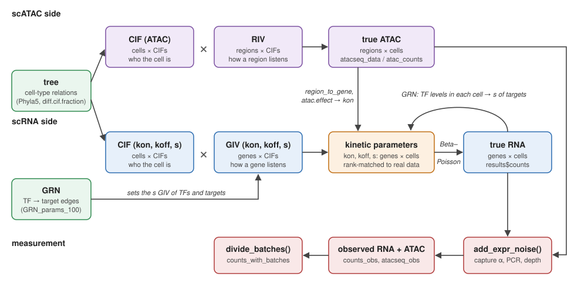

```{css, echo = FALSE}
.bio, .cs, .try, .warn {
  padding: 10px 14px; margin: 14px 0; border-radius: 4px; border-left: 5px solid;
}
.bio  { border-color: #2f8a4f; background: #eef8f1; }
.cs   { border-color: #2b6cb0; background: #edf3fb; }
.try  { border-color: #e69f00; background: #fdf6e7; }
.warn { border-color: #b03a3a; background: #fbeeee; }
.bio > p:first-child::before  { content: "Biology view: ";      font-weight: bold; }
.cs > p:first-child::before   { content: "Modelling view: ";    font-weight: bold; }
.try > p:first-child::before  { content: "Try it: ";            font-weight: bold; }
.warn > p:first-child::before { content: "Watch out: ";         font-weight: bold; }
```

```{r setup, include = FALSE}
knitr::opts_chunk$set(
  echo       = TRUE,
  message    = FALSE,
  warning    = FALSE,
  fig.align  = "center",
  fig.width  = 9,
  fig.height = 4.5
)
```

# What you will do

In this tutorial you will:

1.  simulate paired scRNA-seq + scATAC-seq data for five related cell
    types,
2.  open the simulator up and look at its internal parameters, the
    **cell identity factors (CIF)**, **gene identity vectors (GIV)** and
    **region identity vectors (RIV)**, and see how they become the
    kinetic parameters of each gene in each cell,
3.  compute the *true* mean and noise of every gene in every cell type,
    straight from those kinetic parameters,
4.  add technical noise (capture, amplification, sequencing depth,
    batches) and see what happens to mean, noise, zeros and cell-type
    structure,
5.  *(if time allows)* try to estimate the true mean and noise back from
    the noisy data.

The point of a simulator is that **you know the ground truth**. Real
data never gives you that. Every method you use on real data
(clustering, normalisation, differential expression, GRN inference,
noise estimation) can be scored on simulated data first.

Reference: Li H, Zhang Z, Squires M, Chen X, Zhang X. *scMultiSim:
simulation of single-cell multi-omics and spatial data guided by gene
regulatory networks and cell–cell interactions.* Nature Methods 22,
982–993 (2025). <https://doi.org/10.1038/s41592-025-02651-0>

# 0. Setup {#setup}

If you have not set up the environment yet, follow the `README.md` of
this repository (one `mamba env create` command). Then check that
everything loads:

```{r packages}
suppressPackageStartupMessages({
  library(scMultiSim)            # the simulator
  library(SingleCellExperiment)  # standard container for single-cell data
  library(scuttle)               # QC and normalisation helpers
  library(scran)                 # size factors and modelGeneVar (Part 7)
})
packageVersion("scMultiSim")
set.seed(42)
```

A few plotting helpers, so the analysis code below stays short. You do
not need to read them.

```{r helpers}
# Colour per cell type (Okabe-Ito, colour-blind friendly)
ct_pal  <- c("#E69F00", "#56B4E9", "#009E73", "#CC79A7", "#D55E00")
src_col <- c(true = "steelblue", observed = "firebrick")

# Draw a matrix as a heatmap with row 1 at the top, like it prints.
# row_col: optional colour bar on the left (e.g. cell type of each row).
show_mat <- function(m, main = "", xlab = "", ylab = "", zlim = NULL,
                     col = hcl.colors(64, "viridis"), row_col = NULL,
                     diverging = FALSE) {
  m <- as.matrix(m)
  if (diverging) {
    col <- hcl.colors(64, "Blue-Red 3")
    if (is.null(zlim)) zlim <- c(-1, 1) * max(abs(m), na.rm = TRUE)
  }
  if (is.null(zlim)) zlim <- range(m, finite = TRUE)
  nr <- nrow(m); nc <- ncol(m)
  image(x = seq_len(nc), y = seq_len(nr), z = t(m[nr:1, , drop = FALSE]),
        col = col, zlim = zlim, axes = FALSE, useRaster = TRUE,
        main = main, xlab = xlab, ylab = ylab)
  box()
  if (!is.null(row_col)) {
    w <- max(1, nc * 0.03)
    rect(0.5 - w, nr - seq_len(nr) + 0.5, 0.5, nr - seq_len(nr) + 1.5,
         col = row_col, border = NA, xpd = TRUE)
  }
}

# t-SNE in base graphics, so two embeddings can sit side by side with par(mfrow).
# (scMultiSim::plot_tsne() does the same but returns a ggplot.)
tsne_plot <- function(mat, labels, pal = ct_pal, main = "", perplexity = 30) {
  x   <- t(mat[apply(mat, 1, var) > 0, , drop = FALSE])   # cells x features
  pcs <- prcomp(x, rank. = 30)$x
  set.seed(1)
  emb <- Rtsne::Rtsne(pcs, perplexity = perplexity, pca = FALSE,
                      check_duplicates = FALSE)$Y
  labels <- as.character(labels)
  plot(emb, pch = 16, cex = .45, col = adjustcolor(pal[labels], .7), axes = FALSE,
       xlab = "tSNE 1", ylab = "tSNE 2", main = main)
  box()
  legend("topleft", names(pal), col = pal, pch = 16, bty = "n", cex = .7)
}

# Per-gene mean, variance and Fano factor within each cell type
moments_by_type <- function(mat, groups) {
  do.call(rbind, lapply(levels(groups), function(ct) {
    x  <- mat[, groups == ct, drop = FALSE]
    mu <- rowMeans(x)
    v  <- apply(x, 1, var)
    data.frame(gene = rownames(mat), cell_type = ct, mean = mu, var = v,
               fano = ifelse(mu > 0, v / mu, NA_real_),
               zero = rowMeans(x == 0), row.names = NULL)
  }))
}
```

# 1. The model in one picture {#model}

{width="100%"}

Read the figure from left to right:

- A **tree** describes how the cell types are related. Sister types
  (close on the tree) get similar identities.
- Every cell gets a **cell identity factor (CIF)** vector: a handful of
  numbers that encode "who this cell is" (its type, its state, random
  cell-to-cell variation).
- Every gene gets a **gene identity vector (GIV)** of the same length:
  how strongly that gene responds to each of the cell's factors.
- Multiplying the two, `CIF %*% t(GIV)`, gives one number per cell and
  gene. After mapping it onto a realistic scale, that number becomes a
  **kinetic parameter** of the gene in that cell.
- For ATAC the same trick is used with **region identity vectors
  (RIV)**: `CIF_atac %*% t(RIV)` gives the accessibility of every region
  in every cell. Accessible regions near a gene raise its `kon`, so
  chromatin and RNA are linked.
- A **gene regulatory network (GRN)** lets transcription-factor
  expression drive the transcription rate of its target genes.
- Finally, counts are drawn from the **two-state (telegraph) model of
  transcription**, and you can pass them through a model of the
  **sequencing experiment**.

::: bio
The telegraph model is the standard picture of transcriptional bursting.
A gene's promoter flips between OFF and ON. It turns on at rate
$k_{on}$, turns off at rate $k_{off}$, and while ON it makes mRNA at
rate $s$. mRNA decays at rate $d$. Genes that turn on rarely but make
many molecules each time (small $k_{on}$, large $s/k_{off}$) are
**bursty**. They are noisy from cell to cell even in a perfectly
homogeneous population.
:::

::: cs
At steady state (scMultiSim fixes $d=1$, so all rates are in units of
mRNA lifetime) the count of one gene in one cell is Poisson–Beta:
$$p \sim \mathrm{Beta}(k_{on},\,k_{off}),\qquad m \mid p \sim \mathrm{Poisson}(s\,p).$$
This gives closed-form mean and variance, which we use in Part 5 as the
ground truth: $$\mu = s\,\frac{k_{on}}{k_{on}+k_{off}},\qquad
\mathrm{Var}[m] = \mu + s^{2}\,\frac{k_{on}k_{off}}{(k_{on}+k_{off})^{2}(k_{on}+k_{off}+1)}.$$
The first term is Poisson noise. The second comes from the promoter
switching (bursting).
:::

**Three sources of noise.** Keep these apart when you talk about "noise
of a gene in a cell type":

| Component | Where it comes from in scMultiSim | Controlled by |
|------------------|------------------------------------|------------------|
| **Intrinsic** | Poisson–Beta sampling inside one cell (bursting) | `intrinsic.noise`, `bimod` |
| **Extrinsic** | cells of the same type have slightly different kinetic parameters | `cif.sigma`, non-differential CIFs |
| **Technical** | capture, amplification, sequencing, batches | `add_expr_noise()`, `divide_batches()` |

# 2. Input parameters and simulation {#simulate}

## 2.1 The cell-type tree

With `discrete.cif = TRUE` every **tip** of the tree becomes one cell
type. `Phyla5()` is a built-in five-tip tree. You can rename the tips
(the names are purely cosmetic) or pass any tree from the `ape` package,
e.g. `ape::read.tree(text = "((A:1,B:1):1,C:2);")`.

```{r tree, fig.width = 6, fig.height = 3.5}
phylo_tree <- Phyla5()
phylo_tree$tip.label <- c("spongiocyte", "squirrel_hair_cell", "crabbythelial_cell",
                          "squidoblast", "squidocyte")
plot(phylo_tree, show.tip.label = TRUE, underscore = TRUE,
     tip.color = ct_pal, edge.width = 2, label.offset = 0.05, x.lim = 5.5)
```

`squidoblast` and `squidocyte` sit on a short branch together, so they
will be the most similar pair. `spongiocyte` is the outgroup.

## 2.2 The gene regulatory network

The GRN is a plain data frame with one row per edge: `regulated.gene`,
`regulator.gene`, `regulator.effect`. scMultiSim ships a 100-gene
example with 6 transcription factors.

```{r grn}
data(GRN_params_100)
head(GRN_params_100)
tfs <- sort(unique(GRN_params_100$regulator.gene))
cat(length(unique(c(GRN_params_100$regulated.gene, tfs))), "GRN genes,",
    length(tfs), "regulators (TFs):", tfs, "\n")
```

```{r grn-plot, fig.width = 6, fig.height = 5}
plot_grn(GRN_params_100)
```

## 2.3 Run the simulation

```{r simulate}
n_per_type <- 300L
n_types    <- length(phylo_tree$tip.label)

sim_opts <- list(
  rand.seed         = 42L,
  # --- genes ---
  GRN               = GRN_params_100,  # NA = no GRN; then set num.genes yourself
  num.genes         = 500L,            # 100 GRN genes + 400 unregulated genes
  # --- cells ---
  tree              = phylo_tree,
  discrete.cif      = TRUE,            # TRUE = clusters, FALSE = continuous trajectories
  discrete.pop.size = rep(n_per_type, n_types),
  num.cells         = n_per_type * n_types,
  # --- cell identity ---
  num.cifs          = 40L,             # length of the CIF/GIV vectors
  diff.cif.fraction = 0.8,             # share of CIFs that differ between cell types
  cif.sigma         = 0.2,             # within-type spread of CIFs = extrinsic noise
  vary              = "s",             # which kinetic parameters carry cell-type identity
  # --- RNA ---
  intrinsic.noise   = 1,               # 1 = full Poisson-Beta sampling noise
  bimod             = 0,               # > 0 makes half the genes burstier
  # --- ATAC ---
  atac.effect       = 0.5,             # how much accessibility drives kon (0..1)
  # --- misc ---
  do.velocity       = FALSE,           # FALSE = Poisson-Beta (fast); TRUE = full kinetic model
  debug             = TRUE             # keep internals (RIV, ATAC CIFs) in results$sim
)

# scMultiSim checks types with is.integer(): rep(300, 5) is a *double* and is
# rejected. The L suffixes above matter. Fractions must stay numeric.
stopifnot(
  is.integer(sim_opts$discrete.pop.size),
  length(sim_opts$discrete.pop.size) == ape::Ntip(sim_opts$tree),
  sum(sim_opts$discrete.pop.size) == sim_opts$num.cells
)

results <- sim_true_counts(sim_opts)
```

The `Params Summary` printed above lists the dimensions of every
internal object. We will open each of them in Part 3.

**The input parameters that matter most.** `scmultisim_help("options")`
prints all of them. `run_shiny()` opens an app for exploring them
interactively.

| Parameter | What it does | Typical values / effect |
|------------------|--------------------|----------------------------------|
| `GRN` | TF → target edges; TF expression changes the targets' transcription rate `s` | data frame, or `NA` to switch off |
| `num.genes` | total genes; with a GRN, the genes beyond the GRN are unregulated | ≥ number of GRN genes |
| `tree`, `discrete.cif` | cell-type structure; tips = clusters (`TRUE`) or a continuous trajectory along the tree (`FALSE`) | `Phyla1/3/5()`, any `ape` tree |
| `num.cifs` | length of the identity vectors; more = richer, slower | 20–50 |
| `diff.cif.fraction` | fraction of CIFs that are cell-type specific (the rest vary randomly between cells) | high = clearly separated types |
| `cif.sigma` | SD of CIFs around their cell-type mean; the main knob for **within-type heterogeneity** | 0.1 tight … 1 diffuse |
| `vary` | which of `kon`, `koff`, `s` get differential CIFs | `"s"` (default), `"all"`, `"kon"`, `"except_s"`, … |
| `intrinsic.noise` | weight of the random Poisson–Beta draw vs its mean; scales intrinsic variance by its square | 1 (keep it at 1 for anything noise-related) |
| `bimod` | divides `kon` and `koff` of half the genes by $10^{\text{bimod}}$: slower switching, burstier, bimodal genes | 0 … 1 |
| `scale.s` | multiplies `s`; can be a vector with one value per cell type (e.g. small cells) | 1 |
| `atac.effect` | weight of chromatin accessibility vs CIF×GIV when setting `kon` | 0 (no link) … 1 |
| `region.distrib` | probability that a gene is linked to 0, 1 or 2 regions | `c(0.1, 0.5, 0.4)` |
| `atac.p_zero` | fraction of zeros in the true ATAC matrix | 0.8 |
| `riv.mean/sd/prob`, `giv.mean/sd/prob` | distribution of the identity vectors (`prob` = fraction non-zero) | defaults are fine |
| `do.velocity` | simulate the full kinetic model with unspliced/spliced counts and RNA velocity | slower |

## 2.4 What came out

`results` is an **environment**, not a list, so functions like
`add_expr_noise()` can add to it in place.

```{r results-overview}
ls(results)
```

```{r unpack}
true_counts <- results$counts                   # genes x cells, true mRNA counts
rownames(true_counts) <- paste0("gene", seq_len(nrow(true_counts)))  # uniform names
cell_type   <- factor(results$cell_meta$pop, labels = phylo_tree$tip.label)
names(ct_pal) <- levels(cell_type)
tf_ids      <- paste0("gene", tfs)

dim(true_counts)
table(cell_type)
true_counts[1:5, 1:6]
```

::: warn
Cell type `pop = i` corresponds to `tree$tip.label[i]`. That is why we
can attach the tip labels to `pop` directly. The GRN genes are the first
100 rows, in the order of their numeric IDs, so `gene10` is the TF with
ID 10 in `GRN_params_100`.
:::

```{r tsne-true, fig.width = 6, fig.height = 4.5}
tsne_plot(log2(true_counts + 1), cell_type, main = "true RNA counts")
```

# 3. Inside the simulator: CIF, GIV and kinetic parameters {#internals}

## 3.1 Cell identity factors (CIF)

There is one CIF matrix per kinetic parameter (`kon`, `koff`, `s`). Each
is **cells × CIFs**.

```{r cif-dims}
cif <- results$cif
sapply(cif, dim)
colnames(cif$s)[1:10]
```

Each CIF is one of two kinds:

- **non-differential** (`nonDE`) CIFs are drawn as
  $\mathcal N(1,\,\texttt{cif.sigma}^2)$ for *every* cell, whatever its
  type. They create random cell-to-cell differences, i.e. extrinsic
  noise.
- **differential** (`DE`) CIFs first get one mean per cell type. These
  means are drawn jointly from a multivariate normal whose correlation
  matrix comes from the tree, so sister cell types get similar means.
  Each cell then scatters around its type's mean with SD `cif.sigma`.

## 3.2 Gene identity vectors (GIV)

Each GIV matrix is **genes × CIFs**. A GIV is sparse: by default 30% of
entries are non-zero (`giv.prob`), drawn from
$\mathcal N(\texttt{giv.mean}, \texttt{giv.sd}^2)$. A zero means "this
gene ignores this factor".

```{r giv-dims}
giv <- results$giv
for (p in names(giv)) dimnames(giv[[p]]) <- list(rownames(true_counts), colnames(cif[[p]]))
sapply(giv, dim)
round(sapply(giv, function(g) mean(g[, 1:40] != 0)), 2)   # fraction non-zero
```

## 3.3 From CIF × GIV to kinetic parameters

For every cell and gene, scMultiSim computes `CIF %*% t(GIV)`. This
number only sets the **rank**. The values are then replaced by draws
from a distribution of kinetic parameters estimated from real data
(mouse brain, Zeisel et al.). The result is realistic magnitudes with
the ordering set by the identity vectors. Then:

- `kon` additionally mixes in the **chromatin accessibility** of the
  gene's regions (weight `atac.effect`, Part 4),
- `s` adds the **GRN effect** (TF expression × edge weight) and is
  multiplied by `scale.s`,
- `bimod` divides `kon` and `koff` of half the genes by
  $10^{\text{bimod}}$.

The final kinetic parameters are returned as **genes × cells** matrices:

```{r kinetic}
kon   <- results$kinetic_params$kon
koff  <- results$kinetic_params$koff
s_par <- results$kinetic_params$s

dimnames(kon) <- dimnames(koff) <- dimnames(s_par) <- dimnames(true_counts)
sapply(list(kon = kon, koff = koff, s = s_par), function(x) signif(range(x), 3))
```

::: bio
Useful derived quantities: **burst frequency** $= k_{on}$ (bursts per
mRNA lifetime), **burst size** $= s/k_{off}$ (mRNAs per burst), and
**fraction of time ON** $= k_{on}/(k_{on}+k_{off})$. With `vary = "s"`
cell types differ mostly in how *much* they transcribe, not in how often
they burst. Set `vary = "kon"` to make cell types differ in burst
frequency.
:::

```{r burst-by-type, fig.height = 3.6}
by_type <- function(m) sapply(levels(cell_type), function(ct) rowMeans(m[, cell_type == ct]))
op <- par(mfrow = c(1, 3), mar = c(9, 4.2, 3, 1))
boxplot(log10(by_type(kon)),          las = 2, col = ct_pal, main = "burst frequency (kon)",
        ylab = "log10, mean per gene and type", outcex = .3)
boxplot(log10(by_type(s_par / koff)), las = 2, col = ct_pal, main = "burst size (s / koff)",
        ylab = "log10", outcex = .3)
boxplot(log10(by_type(s_par)),        las = 2, col = ct_pal, main = "transcription rate (s)",
        ylab = "log10", outcex = .3)
par(op)
```

::: try
Where do cell types differ? Correlate the per-type mean `log10(s)` of
`squidoblast` and `squidocyte`, then do the same for `spongiocyte` vs
`squidocyte`. Which pair is more similar, and does it match the tree?
:::

# 4. The multiome part: RIV and chromatin accessibility {#atac}

## 4.1 Region identity vectors and the true ATAC matrix

ATAC uses the same construction as RNA. Each region (peak) has a
**region identity vector (RIV)**. Each cell has a separate set of **ATAC
CIFs**, drawn with the same tree, so accessibility is cell-type
specific. Then:

- `CIF_atac %*% t(RIV)` sets the rank of every region in every cell,
- the lowest `atac.p_zero` (80%) of values are set to 0 (closed
  chromatin),
- the rest are replaced by values sampled from a real scATAC-seq
  density.

By default there are 3 regions per gene
(`length(region.distrib) × num.genes`). The RIV and ATAC CIFs are not
returned by default. They are in `results$sim` because we set
`debug = TRUE`.

```{r atac-objects}
riv      <- results$sim$RIV          # regions x CIFs
cif_atac <- results$sim$CIF_atac     # cells x CIFs
atac     <- results$atacseq_data     # regions x cells (true accessibility)
r2g      <- results$region_to_gene   # regions x genes, 1 = region regulates gene

rbind(RIV = dim(riv), CIF_atac = dim(cif_atac), ATAC = dim(atac), region_to_gene = dim(r2g))
cat("fraction of zeros in the true ATAC matrix:", round(mean(atac == 0), 2), "\n")
cat("genes linked to 0 / 1 / 2 regions:\n"); table(colSums(r2g))
```

::: warn
`results$atacseq_data` is the clean accessibility used inside the
simulation. `results$atac_counts` is the same matrix plus Gaussian
"intrinsic" noise (SD = 1.5 × the mean, clipped at 0). That turns many
true zeros into small positive values. `add_expr_noise()` starts from
`atac_counts`.
:::

```{r tsne-atac, fig.width = 6, fig.height = 4.5}
tsne_plot(log2(results$atac_counts + 1), cell_type, main = "true ATAC (atac_counts)")
```

# 5. Ground truth: mean and noise per cell type {#truth}

## 5.1 From kinetic parameters to mean and variance

Because we know `kon`, `koff` and `s` for every gene in every cell, we
can compute the true mean and variance of every gene in every cell type,
without sampling noise. Within one cell type the **law of total
variance** splits the variance into the two biological parts:

$$\underbrace{\mathrm{Var}_{\text{total}}}_{\text{what you measure}} =
\underbrace{\mathbb{E}_{\text{cells}}\big[\mathrm{Var}[m \mid \text{cell}]\big]}_{\text{intrinsic (bursting)}} +
\underbrace{\mathrm{Var}_{\text{cells}}\big[\mathbb{E}[m \mid \text{cell}]\big]}_{\text{extrinsic (cell-to-cell)}}$$

```{r truth}
sigma_i  <- sim_opts$intrinsic.noise
p_on     <- kon / (kon + koff)
mu_cell  <- s_par * p_on                                              # E[m | cell]
v_beta   <- (kon * koff) / ((kon + koff)^2 * (kon + koff + 1))
var_cell <- sigma_i^2 * (mu_cell + s_par^2 * v_beta)                  # Var[m | cell]

truth <- do.call(rbind, lapply(levels(cell_type), function(ct) {
  i     <- cell_type == ct
  mu_t  <- rowMeans(mu_cell[, i])
  v_int <- rowMeans(var_cell[, i])
  v_ext <- apply(mu_cell[, i], 1, var)
  data.frame(gene = rownames(true_counts), cell_type = ct,
             true_mean = mu_t, true_var_int = v_int, true_var_ext = v_ext,
             true_var = v_int + v_ext,
             true_fano = (v_int + v_ext) / mu_t,
             true_cv2  = (v_int + v_ext) / mu_t^2,
             true_kon  = rowMeans(kon[, i]), true_koff = rowMeans(koff[, i]),
             true_s    = rowMeans(s_par[, i]), row.names = NULL)
}))
truth$cell_type <- factor(truth$cell_type, levels = levels(cell_type))
truth$true_phi  <- truth$true_cv2 - 1 / truth$true_mean   # excess noise over Poisson
truth$frac_ext  <- truth$true_var_ext / truth$true_var    # share of extrinsic noise
head(truth)
```

**Glossary of noise measures**, all computed per gene and cell type:

- **Fano factor** = variance / mean. A Poisson gene has Fano = 1. Bursty
  genes have Fano ≫ 1. It has units (counts), so it scales with
  sequencing depth.
- **CV²** = variance / mean². It is unit-free. For Poisson it equals
  1/mean, so it always falls with expression.
- **excess CV², φ** = CV² − 1/mean. This is the noise beyond Poisson,
  and equals the overdispersion of a negative binomial. It is what most
  noise estimators (NB fits, BASiCS's δ) report.

## 5.2 Does the simulation follow the formulas?

The realised moments of the simulated counts should match the analytic
truth up to sampling error from 300 cells:

```{r truth-check, fig.height = 3.8}
emp <- moments_by_type(true_counts, cell_type)
cmp <- merge(truth, emp, by = c("gene", "cell_type"))
cmp <- cmp[cmp$mean > 0 & cmp$fano > 0, ]

band <- 2 * sqrt(2 / (n_per_type - 1)) / log(2)   # ~2 SE of a log2 variance from n cells
op <- par(mfrow = c(1, 3), mar = c(4.2, 4.2, 3, 1))
plot(log10(cmp$true_mean), log10(cmp$mean), pch = 16, cex = .3,
     col = adjustcolor(ct_pal[cmp$cell_type], .5),
     xlab = "log10 analytic mean", ylab = "log10 simulated mean", main = "mean")
abline(0, 1, col = "red")
plot(log10(cmp$true_fano), log10(cmp$fano), pch = 16, cex = .3,
     col = adjustcolor(ct_pal[cmp$cell_type], .5),
     xlab = "log10 analytic Fano", ylab = "log10 simulated Fano", main = "Fano factor")
abline(0, 1, col = "red")
plot(log10(cmp$true_mean), log2(cmp$fano / cmp$true_fano), pch = 16, cex = .3,
     col = adjustcolor(ct_pal[cmp$cell_type], .5), ylim = c(-2, 2),
     xlab = "log10 analytic mean", ylab = "log2 simulated / analytic Fano",
     main = "residual vs expected sampling error")
abline(h = 0, col = "red"); abline(h = c(-band, band), col = "red", lty = 3)
par(op)
cat("outside the ±2 SE band:", round(100 * mean(abs(log2(cmp$fano / cmp$true_fano)) > band), 1), "%\n")
```

## 5.3 Mean and noise across cell types

```{r type-boxplots, fig.height = 4.2}
op <- par(mfrow = c(1, 2), mar = c(9, 4.5, 3, 1))
boxplot(log10(true_mean) ~ cell_type, data = truth, las = 2, xlab = "", col = ct_pal,
        outcex = .3, ylab = "log10 mean", main = "expression level")
boxplot(log10(true_fano) ~ cell_type, data = truth, las = 2, xlab = "", col = ct_pal,
        outcex = .3, ylab = "log10 Fano", main = "noise")
abline(h = 0, lty = 2, col = "red")
par(op)
```

## 5.4 Same mean, different noise

A gene can keep its mean between two cell types and still change its
noise, e.g. by bursting less often but making bigger bursts.
Differential *expression* tests miss this. Compare the two sister types:

```{r two-types, fig.height = 4}
ct1 <- "squidoblast"; ct2 <- "squidocyte"
a <- truth[truth$cell_type == ct1, c("gene", "true_mean", "true_fano", "true_kon", "true_s")]
b <- truth[truth$cell_type == ct2, c("gene", "true_mean", "true_fano", "true_kon", "true_s")]
p <- merge(a, b, by = "gene", suffixes = c("_1", "_2"))
p$d_mean <- log2(p$true_mean_2 / p$true_mean_1)
p$d_fano <- log2(p$true_fano_2 / p$true_fano_1)

op <- par(mfrow = c(1, 2), mar = c(4.5, 4.5, 3, 1))
plot(log10(p$true_mean_1), log10(p$true_mean_2), pch = 16, cex = .4,
     col = adjustcolor("black", .4), xlab = paste("log10 mean,", ct1),
     ylab = paste("log10 mean,", ct2), main = "mean")
abline(0, 1, col = "red")
plot(p$d_mean, p$d_fano, pch = 16, cex = .4, col = adjustcolor("steelblue", .6),
     xlab = "log2 fold change of mean", ylab = "log2 fold change of Fano",
     main = paste(ct2, "vs", ct1))
abline(h = 0, v = 0, col = "grey60", lty = 2)
rect(-0.5, -10, 0.5, 10, border = "red", lty = 3)
par(op)

same_mean <- p[abs(p$d_mean) < 0.5, ]
head(same_mean[order(-abs(same_mean$d_fano)),
               c("gene", "true_mean_1", "true_mean_2", "true_fano_1", "true_fano_2", "d_fano")], 8)
```

Genes between the dotted red lines keep their mean (less than 1.4-fold
change) but can still change their noise.

::: bio
In cancer, changes in expression *noise* are linked to plasticity,
drug-tolerant persister states and transitions between cell states. A
simulator with known noise lets you check whether a method can detect
such changes at all at your cell numbers and sequencing depth, before
you trust it on tumour data.
:::

# 6. Adding technical noise {#noise}

So far everything was the *true* number of mRNA molecules in each cell.
A real experiment sees only a fraction of them.

## 6.1 `add_expr_noise()`: capture, amplification, sequencing

`add_expr_noise()` writes `results$counts_obs` (RNA) and
`results$atacseq_obs` (ATAC) into the results environment.

| Argument | Meaning |
|--------------------------------------|----------------------------------|
| `protocol` | `"UMI"` (droplet, 10x-like) or `"nonUMI"` (full-length, Smart-seq-like, with gene-length bias) |
| `alpha_mean`, `alpha_sd` | **capture efficiency**: the probability that an mRNA molecule is captured and reverse transcribed. Drawn per cell. 0.05–0.1 is typical for droplets |
| `depth_mean`, `depth_sd` | sequencing reads per cell |
| `nPCR1`, `nPCR2` | PCR cycles (amplification bias) |
| `atac.obs.prob` | probability that an accessible fragment is observed |
| `atac.sd.frac` | extra noise on observed ATAC counts |

```{r add-noise}
ALPHA_MEAN <- 0.1

# Random, and it modifies `results` in place: set a seed so a re-run gives the same data.
set.seed(42)
add_expr_noise(results,
               protocol      = "UMI",
               alpha_mean    = ALPHA_MEAN,
               alpha_sd      = 0.02,
               depth_mean    = 1e5,
               depth_sd      = 3000,
               atac.obs.prob = 0.3,
               atac.sd.frac  = 0.5)

obs_counts <- results$counts_obs$counts          # genes x cells, observed UMI counts
dimnames(obs_counts) <- dimnames(true_counts)
atac_obs   <- results$atacseq_obs                # regions x cells, observed ATAC
stopifnot(dim(obs_counts) == dim(true_counts))
```

## 6.2 What happened to the counts?

```{r count-dists, fig.width = 10, fig.height = 3.6}
x  <- as.vector(true_counts)
xo <- as.vector(obs_counts)
pct_zero_true <- 100 * mean(x == 0)
pct_zero_obs  <- 100 * mean(xo == 0)
pct_false     <- 100 * mean(xo == 0 & x > 0)
xl <- range(log10(c(x, xo) + 1))

op <- par(mfrow = c(1, 3), mar = c(4.4, 4.4, 3, 1))
hist(log10(x + 1), breaks = 60, xlim = xl, col = "steelblue", border = "white",
     main = "true counts", xlab = "log10(count + 1)")
legend("topright", sprintf("zeros: %.1f%%", pct_zero_true), bty = "n")
hist(log10(xo + 1), breaks = 60, xlim = xl, col = "firebrick", border = "white",
     main = "observed counts", xlab = "log10(count + 1)")
legend("topright", bty = "n", c(sprintf("zeros: %.1f%%", pct_zero_obs),
                                sprintf("of which false zeros: %.1f%%", pct_false)))

# Library size per cell, and the capture efficiency that actually happened
lib_true <- colSums(true_counts); lib_obs <- colSums(obs_counts)
plot(lib_true, lib_obs, pch = 16, cex = .4, col = adjustcolor(ct_pal[cell_type], .6),
     xlab = "true molecules per cell", ylab = "observed UMIs per cell",
     main = "library size")
abline(0, ALPHA_MEAN, col = "red", lty = 2)
par(op)
cat("observed / true molecules:", round(sum(xo) / sum(x), 3), "(alpha_mean =", ALPHA_MEAN, ")\n")
```

Where do the extra zeros come from?

```{r dropout, fig.width = 5.5, fig.height = 4.2}
# Dropout: chance that a gene with x true molecules is observed as 0
nz <- x > 0 & x <= 40
d  <- tapply(xo[nz] == 0, x[nz], mean)
plot(as.numeric(names(d)), d, pch = 16, xlab = "true count in the cell",
     ylab = "P(observed = 0)", main = "dropout depends on molecule count")
curve((1 - ALPHA_MEAN)^x, add = TRUE, col = "red", lwd = 1.5)
legend("topright", "(1 - alpha)^x", col = "red", lwd = 1.5, bty = "n")
```

::: bio
"Dropouts" here are not a separate mechanism. They are what you get from
sampling 10% of the molecules. A gene with 5 molecules in a cell is
missed with probability $0.9^5 \approx 59\%$. A gene with 40 molecules
is almost never missed. No zero-inflation is needed to explain the extra
zeros. This matches what is known about UMI data.
:::

## 6.3 Mean and noise, true vs observed

If each molecule is captured independently with probability $\alpha$
(binomial thinning), there are simple laws for what happens to each
moment:

| Quantity | After capture |
|-----------------------------|-------------------------------------------|
| mean | $\mu_{obs} = \alpha\,\mu$ |
| Fano | $F_{obs} = 1 + \alpha\,(F - 1)$: **collapses toward 1 (Poisson)** |
| CV² | $CV^2_{obs} = CV^2 + \frac{1-\alpha}{\alpha\mu}$: inflated, worst for lowly expressed genes |
| excess CV², φ | $\phi_{obs} = \phi$: **preserved** |

So "noise" can go down (Fano), up (CV²) or stay the same (φ) depending
on which measure you use. That is the most important practical message
of this section.

```{r true-vs-obs, fig.width = 11, fig.height = 4}
m_true <- moments_by_type(true_counts, cell_type)
m_obs  <- moments_by_type(obs_counts,  cell_type)
co <- merge(m_true, m_obs, by = c("gene", "cell_type"), suffixes = c("_true", "_obs"))

# One point per gene and cell type, placed at its true expression level.
# Blue = computed from the true counts, red = from the observed counts.
# Lines: loess fit for each.
true_vs_obs <- function(stat, ylab, main, hline = NULL) {
  xt <- log10(co$mean_true)
  yt <- log10(co[[paste0(stat, "_true")]])
  yo <- log10(co[[paste0(stat, "_obs")]])
  ok_t <- is.finite(xt) & is.finite(yt)
  ok_o <- is.finite(xt) & is.finite(yo)
  plot(NA, xlim = range(xt[ok_t | ok_o]), ylim = range(c(yt[ok_t], yo[ok_o])),
       xlab = "true mean count per cell (log10)", ylab = ylab, main = main)
  if (!is.null(hline)) abline(h = hline, col = "grey60", lty = 2)
  points(xt[ok_t], yt[ok_t], pch = 16, cex = .3, col = adjustcolor(src_col["true"], .3))
  points(xt[ok_o], yo[ok_o], pch = 16, cex = .3, col = adjustcolor(src_col["observed"], .3))
  for (src in c("true", "observed")) {
    y  <- if (src == "true") yt else yo
    ok <- if (src == "true") ok_t else ok_o
    d    <- data.frame(x = xt[ok], y = y[ok])
    fit  <- loess(y ~ x, data = d, span = .3)
    grid <- data.frame(x = seq(min(d$x), max(d$x), length.out = 200))
    lines(grid$x, predict(fit, grid), col = src_col[src], lwd = 2.5)
  }
  legend("topleft", names(src_col), col = src_col, lwd = 2.5, bty = "n")
}

op <- par(mfrow = c(1, 3), mar = c(4.4, 4.4, 3, 1))
true_vs_obs("mean", "mean count per cell (log10)",  "mean expression")
true_vs_obs("var",  "variance across cells (log10)", "variance")
true_vs_obs("fano", "Fano factor (log10)",           "Fano factor (variance / mean)", hline = 0)
par(op)

cat("median observed/true mean:", round(median(co$mean_obs / co$mean_true, na.rm = TRUE), 3), "\n")
cat("median Fano true -> observed:", round(median(co$fano_true, na.rm = TRUE), 1), "->",
    round(median(co$fano_obs, na.rm = TRUE), 2), "\n")
```

Per cell type:

```{r per-type-true-obs, fig.height = 4.2}
long <- rbind(data.frame(cell_type = co$cell_type, source = "true",
                         mean = co$mean_true, fano = co$fano_true),
              data.frame(cell_type = co$cell_type, source = "observed",
                         mean = co$mean_obs, fano = co$fano_obs))
long$cell_type <- factor(long$cell_type, levels = levels(cell_type))
long$source    <- factor(long$source, levels = c("true", "observed"))
at  <- rep(seq(1, by = 3, length.out = n_types), each = 2) + c(0, 1)
ctr <- seq(1.5, by = 3, length.out = n_types)

op <- par(mfrow = c(1, 2), mar = c(9, 4.5, 3, 1))
boxplot(log10(mean) ~ source + cell_type, data = long, at = at, col = src_col,
        xaxt = "n", outcex = .3, xlab = "", ylab = "log10 mean", main = "expression level")
axis(1, at = ctr, labels = levels(cell_type), las = 2)
legend("bottomleft", names(src_col), fill = src_col, bty = "n", cex = .8)
boxplot(log10(fano) ~ source + cell_type, data = long, at = at, col = src_col,
        xaxt = "n", outcex = .3, xlab = "", ylab = "log10 Fano", main = "noise (Fano)")
axis(1, at = ctr, labels = levels(cell_type), las = 2)
abline(h = 0, lty = 2, col = "red")
par(op)

# Genes that capture silenced completely in a cell type
lost <- with(co, tapply(mean_true > 0 & mean_obs == 0, cell_type, sum))
lost[levels(cell_type)]
```

Does the cell-type structure survive?

```{r tsne-obs, fig.width = 10, fig.height = 4.5}
op <- par(mfrow = c(1, 2))
tsne_plot(log2(true_counts + 1), cell_type, main = "true RNA")
tsne_plot(log2(obs_counts + 1),  cell_type,
          main = sprintf("observed RNA (alpha = %.2f)", ALPHA_MEAN))
par(op)
```

## 6.4 ATAC after technical noise

```{r atac-obs, fig.height = 3.8}
op <- par(mfrow = c(1, 2), mar = c(4.4, 4.4, 3, 1))
hist(log2(as.vector(results$atac_counts) + 1), breaks = 60, col = "plum", border = "white",
     main = sprintf("true ATAC (zeros %.0f%%)", 100 * mean(results$atac_counts == 0)),
     xlab = "log2(accessibility + 1)")
hist(log2(as.vector(atac_obs) + 1), breaks = 60, col = "purple4", border = "white",
     main = sprintf("observed ATAC (zeros %.0f%%)", 100 * mean(atac_obs == 0)),
     xlab = "log2(accessibility + 1)")
par(op)
```

```{r tsne-atac-obs, fig.width = 10, fig.height = 4.5}
op <- par(mfrow = c(1, 2))
tsne_plot(log2(results$atac_counts + 1), cell_type, main = "true ATAC")
tsne_plot(log2(atac_obs + 1),            cell_type, main = "observed ATAC")
par(op)
```

## 6.5 Batch effects

`divide_batches()` randomly assigns cells to batches and writes
`results$counts_with_batches` and `results$atac_with_batches`.

```{r batches, fig.width = 10, fig.height = 4.5}
set.seed(7)
divide_batches(results, nbatch = 2, effect = 1)
batch       <- factor(results$cell_meta$batch)
obs_batched <- results$counts_with_batches
table(batch)

op <- par(mfrow = c(1, 2))
tsne_plot(log2(obs_batched + 1), batch, pal = c("1" = "grey25", "2" = "orange"),
          main = "with batch effect: coloured by batch")
tsne_plot(log2(obs_batched + 1), cell_type, main = "with batch effect: coloured by cell type")
par(op)
```

For the rest of the tutorial we use `obs_counts` (technical noise,
**no** batches). This keeps the comparison with the ground truth clean.

# 7. Estimating mean and noise back *(optional)* {#estimate}

## 7.1 Library-size normalisation

Each cell's library size varies because its capture efficiency and
sequencing depth vary. Deconvolution size factors (scran) estimate that
per-cell scaling. In a simulation we can check them against the capture
efficiency that actually happened.

```{r normalise, fig.height = 3.6}
sce <- SingleCellExperiment(assays = list(counts = obs_counts),
                            colData = DataFrame(cell_type = cell_type))
clust <- quickCluster(sce)
sce   <- computePooledFactors(sce, clusters = clust)
sf    <- sizeFactors(sce)
norm_counts <- t(t(obs_counts) / sf)
sce   <- logNormCounts(sce)        # log2(count / size factor + 1), used by modelGeneVar

alpha_actual <- colSums(obs_counts) / colSums(true_counts)
op <- par(mfrow = c(1, 3), mar = c(4.4, 4.4, 3, 1))
hist(colSums(obs_counts),  breaks = 50, col = "firebrick", border = "white",
     main = "before", xlab = "UMIs per cell")
hist(colSums(norm_counts), breaks = 50, col = "darkgreen", border = "white",
     main = "after size-factor normalisation", xlab = "normalised counts per cell")
plot(alpha_actual, sf, pch = 16, cex = .4, col = adjustcolor(ct_pal[cell_type], .6),
     xlab = "actual capture efficiency", ylab = "size factor",
     main = sprintf("r = %.2f", cor(alpha_actual, sf)))
par(op)
```

The size factors do not perfectly track capture efficiency. Cell types
also differ in total mRNA content (`colSums(true_counts)`).
Deconvolution keeps part of that real biological difference and removes
the rest.

## 7.2 Mean and noise with `modelGeneVar()`

`scran::modelGeneVar()` is the standard way to find "highly variable
genes" in a scRNA-seq workflow. For every gene it computes the **mean**
and the **variance** of the log-normalised expression. Variance changes
with the mean, so it then fits a curve through variance against mean
across all genes (the mean–variance trend). It splits each gene's
variance into:

- **expected variance**: the value of the trend at the gene's mean, the
  variance you would expect from its expression level alone,
- **excess variance** (`bio`): total variance minus expected variance.
  Positive means the gene varies more between cells than expected from
  its mean, negative means less.

We run it separately for each cell type, so the differences between
cell types do not count as noise.

```{r model-gene-var}
est <- do.call(rbind, lapply(levels(cell_type), function(ct) {
  dec <- modelGeneVar(sce[, cell_type == ct])
  data.frame(gene = rownames(dec), cell_type = ct,
             est_mean = dec$mean, est_total = dec$total,
             est_trend = dec$tech, est_bio = dec$bio, row.names = NULL)
}))
res <- merge(truth, est, by = c("gene", "cell_type"))
res$obs_mean <- m_obs$mean[match(paste(res$gene, res$cell_type),
                                  paste(m_obs$gene, m_obs$cell_type))]   # observed UMIs/cell
head(res[, c("gene", "cell_type", "true_mean", "est_mean", "true_fano", "est_bio")])
```

## 7.3 How close are the estimates to the truth?

We know the true mean and the true Fano factor (Part 5) of every gene
in every cell type, so we can check the estimates directly.

**Mean.** `modelGeneVar()` reports the mean on the log2 scale, so we put
the true mean on the same scale: log2(true mean + 1). One point per
gene and cell type.

```{r mgv-mean, fig.width = 5.5, fig.height = 5}
x <- log2(res$true_mean + 1)
y <- res$est_mean
lim <- range(c(x, y))
plot(x, y, pch = 16, cex = .4, col = adjustcolor(ct_pal[as.character(res$cell_type)], .5),
     xlim = lim, ylim = lim, asp = 1,
     xlab = "true mean, log2(molecules per cell + 1)",
     ylab = "estimated mean (modelGeneVar)",
     main = sprintf("mean: true vs estimated (Spearman %.2f)",
                    cor(x, y, method = "spearman")))
abline(0, 1, col = "grey50", lty = 2)
fit  <- loess(y ~ x, span = .3)
grid <- seq(min(x), max(x), length.out = 200)
lines(grid, predict(fit, data.frame(x = grid)), col = "red", lwd = 2)
legend("topleft", c(levels(cell_type), "estimate = truth", "loess fit"),
       col = c(ct_pal, "grey50", "red"), pch = c(rep(16, n_types), NA, NA),
       lty = c(rep(NA, n_types), 2, 1), lwd = c(rep(NA, n_types), 1, 2),
       bty = "n", cex = .75)
```

The points lie on a tight curve, so the estimate keeps the order of the
genes almost perfectly. They sit below the dashed line because only
about 10% of the molecules are captured (`alpha_mean`), and normalisation
puts every cell on the scale of an average *observed* library, not back
to the true number of molecules.

**Noise.**

```{r mgv-vs-truth, fig.width = 5.5, fig.height = 4.5}
lowexp <- res$obs_mean < 0.5   # fewer than one UMI every 2 cells
expr_col <- adjustcolor(ifelse(lowexp, "orange", "darkgreen"), .4)

plot(log10(res$true_fano), res$est_bio, pch = 16, cex = .3, col = expr_col,
     xlab = "true Fano factor (log10)", ylab = "excess variance (bio)",
     main = sprintf("noise (Spearman %.2f)",
                    cor(res$true_fano, res$est_bio, method = "spearman")))
abline(h = 0, col = "grey60", lty = 2)
legend("topleft", c("obs. mean < 0.5 UMI", "obs. mean >= 0.5 UMI"),
       col = c("orange", "darkgreen"), pch = 16, bty = "n", cex = .8)

# Accuracy per expression bin: where can noise be measured at all?
bins <- cut(log10(res$obs_mean + 1e-3), c(-Inf, -1, -0.5, 0, 0.5, 1, Inf),
            labels = c("<0.1", "0.1-0.3", "0.3-1", "1-3", "3-10", ">10"))
data.frame(genes = as.vector(table(bins)),
           spearman_noise = round(tapply(seq_len(nrow(res)), bins, function(i)
             cor(res$est_bio[i], res$true_fano[i], method = "spearman")), 2),
           row.names = levels(bins))
```

- **Noise.** The excess variance follows the true Fano factor well for genes with at
  least about 0.1 UMI per cell, and poorly below that. With so few
  molecules per cell, counting noise swamps the biological noise. This
  limit comes from capture efficiency and cell numbers, not from the
  method.
- **Negative excess variance.** About half of the genes get a negative
  `bio`. The trend is fitted through all genes, so it passes through
  their middle. Excess variance is therefore *relative to the other
  genes*, not an absolute amount of noise. Here most genes are bursty,
  so the expected variance already includes a lot of biological noise.


# Session info

```{r session}
sessionInfo()
```
